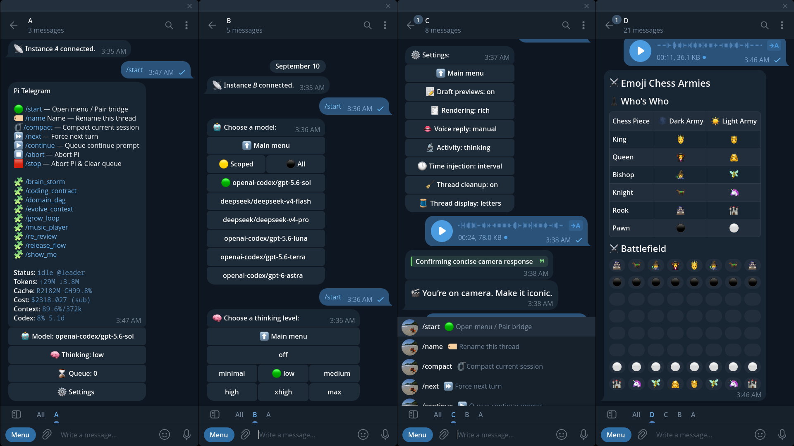

# pi-telegram



**A Telegram companion hub for live Pi sessions.**

`pi-telegram` turns a private Telegram DM into a mobile operator surface for Pi. It accepts prompts, queues work, streams readable previews, delivers final replies and files, exposes safe controls, and lets companion extensions add Telegram-native capabilities without owning a second bot loop.

It is a **runtime adapter**, not a remote terminal. Start or supervise work in the Pi TUI, then continue from Telegram while away from the keyboard. In Threaded Mode, a durable Workspace binding uses Pi's stable public session identity to restore the same Telegram Thread when that session resumes; live instance ownership and the exact Telegram target still authorize routing. The bridge preserves Pi session semantics instead of pretending Telegram is a PTY, shell, process launcher, or session browser. That boundary is the product: Telegram gets safe runtime handles, not raw terminal power.

While connected, Telegram receives intermediate updates and final replies from local Pi work as well as Telegram-originated turns. The `Activity` setting controls whether thinking and tool details are shown. See [Outbound](docs/outbound.md#public-assistant-output) for delivery behavior.

This repository is an actively maintained standalone fork of [`badlogic/pi-telegram`](https://github.com/badlogic/pi-telegram). It started from upstream commit [`cb34008`](https://github.com/badlogic/pi-telegram/commit/cb34008460b6c1ca036d92322f69d87f626be0fc) and has since diverged substantially.

## Install

From npm:

```bash
pi install npm:@llblab/pi-telegram
```

From git:

```bash
pi install git:github.com/llblab/pi-telegram
```

Installed npm/git packages expose bundled Skills through their `pi.skills` manifest, so Pi package filters and package provenance remain authoritative. A checkout auto-discovered directly under Pi's user or project `extensions` directory contributes its adjacent source Skills even when Pi selects the checkout's compiled entrypoint; the two discovery paths are mutually exclusive.

The extension requires Pi `1.0.0` or newer, matching the package's peer dependencies. Its Activity API uses the public `agent_settled` lifecycle event to keep retries/continuations under one activity identity and release that identity only after the run fully settles.

Pi is the primary and only officially supported host. Narrow host-neutral adapters preserve ordered prompt blocks and normalize synchronous or asynchronous legacy/generic settings services for Pi-compatible hosts, but this is best-effort compatibility rather than an OMP support guarantee. Alternate-host shims must still reproduce required Pi lifecycle semantics—especially `agent_settled`—and their maintainers own ongoing validation.

## Quick Start

### 1. Create a Telegram bot

1. Open [@BotFather](https://t.me/BotFather). BotFather's chat commands and Mini App are different surfaces; Telegram Desktop supports the Mini App through **Open App** / **Menu** in the BotFather profile.
2. Run `/newbot`.
3. Pick a name and username.
4. Copy the bot token.

### 2. Configure Pi

Run this inside Pi:

```bash
/telegram-setup
```

Paste the bot token. If `~/.pi/agent/telegram.json` already contains a saved token, setup offers it as the default. If no saved token exists, setup prefills the first supported alias (`TELEGRAM_BOT_TOKEN`, `TELEGRAM_BOT_KEY`, `TELEGRAM_TOKEN`, or `TELEGRAM_KEY`) as an environment reference such as `$TELEGRAM_BOT_TOKEN`, validates the resolved value, and persists the reference instead of copying the secret. Bot/session identity persists under `profiles.default`; shared handlers and assistant/voice/time settings remain top-level. `/telegram-setup default` and `/telegram-connect default` are exact aliases for the bare commands. Use `/telegram-setup <name>` only when you want an additional bot profile. Cancelling or failing named-profile token validation leaves the currently active profile and polling runtime unchanged; setup reports the profile as saved and connected only after polling startup succeeds.

### 3. Connect this Pi instance and its active session

```bash
/telegram-connect
```

The connected Pi instance owns Telegram polling. Use `/telegram-connect <profile>` to activate a named profile. Each profile is a parallel bot runtime with isolated polling, diagnostics, Threaded Mode state, and local bus transport; the `default` profile keeps unsuffixed runtime paths. In classic mode each profile uses a singleton lock. When Telegram private-chat Threaded Mode is available, one live instance becomes the profile's leader and later visible Pi instances register as followers. Reopening or resuming the same Pi session restores its remembered Thread at session startup. If `/resume` immediately follows `/telegram-connect`, or the bridge is already connected, connection intent follows the switch: the destination restores its own Thread/slot or receives a new binding, never the source session's Thread. Otherwise, a distinct unbound session still requires explicit `/telegram-connect`.

`/telegram-connect` keeps working when the shared runtime `state.json` is damaged. If it is malformed, foreign or contains invalid evidence, the connecting leader replaces it with a fresh empty state and continues. Every profile then forgets old Thread bindings, slots, unfinished Restore/temporary work and polling continuity; `telegram.json`, Pi history and the released `tmp/telegram` are untouched. Permission errors still stop connection. See [Damaged-State Reset](./docs/architecture.md#damaged-state-reset-operator-approved).

If Thread creation was interrupted, an explicit `/telegram-connect` can reset that unfinished attempt and try a fresh connection without clearing queued prompts or taking over a live leader. A lost Telegram response may leave an extra tab behind; known tabs are reused rather than blindly recreated. Both peers need connection-recovery support. See [Connection Recovery](./docs/architecture.md#explicit-connection-recovery).

The prompt queue is session-local. Before a reload or restart, let it drain or knowingly accept losing waiting work and re-send what still matters afterwards; nothing is replayed automatically.

Ordinary network or admission failures use exponential retry pauses capped at 30 seconds, without permanently stopping after an arbitrary attempt count. The poller recovers when the outage clears. Explicit `/telegram-disconnect` still attempts to stop its captured local transport if Thread cleanup is unavailable; it reports unconfirmed cleanup rather than successful deletion, and an old disconnect cannot stop a new connection. Incomplete stop/release remains visible; check `/telegram-status --debug` and keep Pi open.

Persistent competing `getUpdates` clients cause a bounded transport stand-down rather than endless retries. Accepted local work remains queued/executable, but Telegram delivery stops. Inspect `/telegram-status --debug`, stop the competing client, then reconnect. See [Runtime Ownership](./docs/architecture.md#runtime-ownership).

### 4. Pair your Telegram account

Open the bot DM and send:

```text
/start
```

The first Telegram user successfully paired with the bot becomes the allowed owner. Pairing is saved before the candidate is authorized in memory; a failed save remains unpaired and can retry without overwriting an already configured owner. Other users are ignored. This is a first-contact security boundary: keep the bot private and send `/start` immediately after connecting. For stricter setup, restrict access to your account in the BotFather Mini App when that control is available, or preconfigure your numeric Telegram user id as `profiles.default.allowedUserId` in the existing `~/.pi/agent/telegram.json` before connecting (preserve the saved `botToken` and any other settings):

```json
{
  "profiles": {
    "default": {
      "botToken": "<existing-token>",
      "allowedUserId": 123456789
    }
  }
}
```

After required pairing state is persisted, `/start` is admitted independently from best-effort menu rendering and BotFather command-list synchronization, so either Telegram side effect can fail or remain in flight without stopping later inbound updates.

### 5. Enable optional bot capabilities in BotFather

Enable the optional capabilities the bridge needs in the [@BotFather](https://t.me/BotFather) Mini App. On Telegram Desktop, open the BotFather profile and use **Open App** / **Menu**, select the configured bot, open **Settings**, and toggle **Threaded Mode** there rather than relying only on the inline chat-command interface. The bridge does not fail loudly when a capability is off; the feature simply never triggers.

1. Enable guest mode so the bot can answer mentions and replies in chats where it is not a member.
2. Enable private-chat Threaded Mode; when it is available, one live instance becomes the profile's leader and later visible Pi instances register as followers. Without it, the bridge stays in classic single-owner DM mode.
3. Make the bot an administrator in any chat where the queue reaction shortcuts should work. Reaction updates require admin rights, so the shortcuts silently do nothing in non-admin chats; private chats deliver reactions without admin rights.

## What It Feels Like

- Start a task in the terminal, walk away, and keep supervising it from your phone.
- Send another prompt while Pi is busy; it becomes a queued Telegram turn instead of interrupting the active run.
- Open `/start` to inspect status, model, thinking, settings, prompt templates, and queue controls.
- Send voice, images, files, replies, edits, or media groups; the bridge turns them into Pi context.
- Ask for an artifact; `telegram_attach` returns it before the turn's separate final text, or through explicit direct Telegram delivery.
- In Threaded Mode, run multiple visible Pi instances through one bot, each with its own Telegram thread.
- Configure named profiles to run independent Telegram bots from the same Pi agent directory without sharing transport or routing state.

## Product Model

| Lens | What `pi-telegram` owns |
| --- | --- |
| Operator companion | A phone-width control surface for the active session of a running Pi instance |
| Runtime adapter | Telegram targets mapped to Pi instances, then into each instance's current session lifecycle, queueing, previews, final replies, and artifacts |
| Telegram UI harness | Menus, settings, callbacks, Rich Markdown, drafts, active status, buttons, voice, and files |
| Multi-instance organism | One leader plus explicit visible followers routed through Telegram private-chat threads |
| Extension platform | Commands, sections, status rows, update handlers, inbound/outbound handlers, and voice providers |
| Safety boundary | No hidden Pi processes, no fake terminal, no PTY tricks, no arbitrary TUI slash-command forwarding |

## Feature Showcase

`pi-telegram` is intentionally broad: it is a Telegram-shaped runtime surface, not only a message relay. This catalogue keeps the practical feature surface visible while detailed contracts stay in `/docs`.

| Surface | What you can do | Why it matters |
| --- | --- | --- |
| Prompt intake | Send text, replies, edits, images, files, albums, voice notes, forwards with adjacent comments, and handler output into Pi. | Telegram becomes a real mobile input surface; one forward-plus-comment gesture stays one attributed prompt even for photo-only forwards. |
| Queue control | Inspect waiting turns, keep or skip stale work, promote important prompts, continue, abort, stop, or force the next queued item. | Long Pi tasks keep running while new mobile prompts stay visible and controllable instead of interrupting or disappearing. |
| Operator menu | Use `/start` for status, prompt templates, model, thinking, settings, queue, extension sections, and diagnostics. | The bot is an operator panel, not a command cheat sheet. |
| Prompt templates | Run Pi prompt templates as Telegram-safe commands such as `/fix_tests`. | Reusable local workflows become phone-accessible without exposing arbitrary terminal commands. |
| Model and thinking | Switch model or thinking level from Telegram through safe continuation flows, including an active local/TUI agent run. | Mobile control can stop, switch, and resume in the same session context instead of returning a false busy dead end. |
| Compaction | Confirm `/compact`, show native active status during compaction, and preserve Telegram-owned turn semantics. | Context maintenance is visible and safe from the phone. |
| Draft previews | Show Telegram's native `…typing` indicator whenever the connected instance is doing agent work, or enable Rich Draft previews for streamed answer text. | Local prompts, Telegram turns, and autonomous continuations remain visibly active while draft visibility stays independent from final rendering. |
| Activity | Keep the default `verbose` technical surface, show only `thinking`, show only `tools`, select `stream` for one live message per turn with quoted activity above the answer, or select `quiet` for answer-only delivery. Every instance reloads this shared file-backed choice before a new agent run; thinking accumulates for two seconds and then updates at most every two seconds in a headerless expandable quote, while each tool uses one iconless closed root row containing nested evidence details. | Persistent collapsed technical activity minimizes chat height and stays bounded, redacted, target-fenced, free of URL previews, and visually separate from semantic assistant answers. |
| Assistant rendering | Choose Native Rich Markdown or legacy Markdown-to-HTML for final assistant replies. | Renderer compatibility is explicit instead of being conflated with draft previews. |
| Bridge UI rendering | Render thinking through headerless expandable HTML with inline emphasis/code, render each tool as an iconless native Rich root details tree with immediately visible arguments and collapsed secondary evidence, and keep menus, queue controls, status, settings, diagnostics, and sections on Telegram HTML/plain UI. | Harness-owned surfaces remain operationally predictable and visually distinct from model-authored answers. |
| Inbound files | Download inbound files to the Pi agent temp directory with size limits. | Screenshots, PDFs, datasets, and artifacts enter Pi as inspectable local files. |
| Outbound artifacts | Return generated files through `telegram_attach` before separate active-turn text, or by explicit direct delivery. | Agents send real artifacts in causal order, not as pasted blobs. |
| Voice input | Route audio through configured command-template handlers, programmatic handlers, or STT providers. | Voice notes become usable prompt context. |
| Voice output | Choose `manual`, `mirror`, or `always`; active automatic turns carry one compact `[voice] delivery: automatic voice` line, while explicit `telegram_voice` remains available. | Voice policy stays dynamic and model-legible without duplicating the full action contract in every prompt. |
| Buttons | Use `telegram_button` comments for footer buttons or fenced blocks for native button rows between paragraphs. | Assistant-authored choices become native Telegram interactions. |
| Generative Apps | Install or explicitly replace a reviewed `.mjs` application whose generated JSON button view may mix direct `app::method` actions with ordinary model prompts. | Repeated games, controls, tutors, and adapters compile routine interaction without losing selective model interpretation, explanation, or adaptation. |
| Callback routing | Route known callbacks to the owner extension and unknown callbacks back into Pi. | Companion extensions can build UI without polling Telegram themselves. |
| Threaded Mode | Run one leader plus visible follower Pi instances through named private-chat threads. | One bot can host a local multi-instance Pi organism without hidden process spawning. |
| Reroute and restore | Give text, voice, files and albums sent from `All`, plus unknown threads, explicit reroute and replace/restore choices. | Reroute from a routing tab forwards the prompt into the selected Thread before agent admission and anchors replies there; cleanup still requires source ACKs. Restore rebinds the tab and may remove only the replaced old tab after positive cleanup proofs. Blocked cleanup preserves the relocation and protected work. |
| Extension sections | Add menu sections, commands, status rows, settings, callbacks, and delivery helpers from companion extensions. | `pi-telegram` becomes a platform surface for other Pi extensions. |
| Runtime diagnostics | Use `/telegram-status` and recent runtime events for connection, role, negotiated bus protocol/build/capabilities, separate polling and inbound-worker progress, journal depth, local/foreign queue ownership, automatic retry waits, transport, and failures. | Compatible build skew, foreign semantic authority, a healthy poller, durable backoff and an infrastructure-blocked worker remain distinguishable without hidden logs. |
| Safety and ownership | Pair one owner, lock transport, scope targets, and reject fake terminal behavior. | Remote access remains explicit, bounded, and understandable. |

## Core Loop

```text
Telegram message
  -> Telegram turn
  -> queue or active dispatch
  -> Pi agent lifecycle
  -> streaming preview / native active status
  -> final Rich Markdown reply
  -> optional files, voice, buttons, or callback actions
```

The bridge keeps Telegram responsive without stealing Pi's runtime model. Queueing, model changes, compaction, aborts, final delivery, and direct artifact sends all stay scoped to the Pi instance that accepted the work.

## Telegram Controls

Use these in the bot DM.

| Command | Purpose |
| --- | --- |
| `/start` | Pair when needed and open the main operator menu |
| `/name [Name]` | Set a manual Thread title immediately, or open rename/reset controls when Name is omitted |
| `/new` | Start a new Pi session in the current classic chat or Thread after confirming the bridge is idle |
| `/compact` | Confirm and run session compaction when safe |
| `/next` | Dispatch the next queued turn, aborting first if needed |
| `/continue` | Enqueue a priority continuation prompt |
| `/abort` | Abort the active run while preserving the queue |
| `/stop` | Abort the active run and clear waiting Telegram turns |

Hidden compatibility shortcuts: `/help`, `/status`, `/model`, `/thinking`, `/queue`, and `/settings` jump into the same menu system.

## Pi Commands

Run these inside Pi.

| Command | Purpose |
| --- | --- |
| `/telegram-setup` / `/telegram-setup default` | Save or update `profiles.default` |
| `/telegram-setup <profile>` | Save or update a named-profile bot token |
| `/telegram-connect` / `/telegram-connect default` | Activate `profiles.default` and acquire its transport ownership |
| `/telegram-connect <profile>` | Activate a named profile and acquire its transport ownership |
| `/telegram-disconnect` | Confirm, then stop polling, release ownership, and delete this instance's Threaded Mode tab; graceful Pi quit always preserves restart ownership and independently deletes the tab only when automatic cleanup is enabled |
| `/telegram-status` | Inspect connection, mode, separate polling/worker progress, journal depth, queue, transport, automatic retry state, and recent diagnostics |

Named profile identifiers contain only lowercase ASCII letters and digits (maximum 32 characters); `default`, `main`, and `active` remain reserved. If graceful thread deletion was interrupted, a same-profile replacement reuses its still-active thread and cancels the superseded cleanup instead of deleting and recreating the tab during startup.

## Main Surfaces

In Threaded Mode, `All` is input-only: messages enter temporary routing tabs, and Pi replies stay in bound Threads. Missing routing or delivery targets fail closed instead of sending fallback messages to All. There is no automatic cleanup of old All output. Classic DM behavior is unchanged.

### Operator Menu

`/start` opens the Telegram-native control panel: status, prompt-template commands, model selection, thinking level, settings, queue controls, and extension sections. It is the primary Telegram UI; reaction shortcuts are secondary queue affordances.

### Queue Runtime

Messages sent while Pi is busy become queued turns. Queue controls let you inspect, prioritize, keep or skip, and dispatch work without touching the terminal.

Use reactions or the queue menu to control waiting prompts. Only `👍`, `👎`, and `🔥` have queue semantics; all other reactions are ignored.

Priority — when the prompt runs:
- **Normal — no dedicated reaction emoji.** The default lane for ordinary queued work.
- **Priority — `👍`.** Moves waiting input ahead of Normal work, without interrupting the active task.
- **Steer — `🔥`.** Inserts ready input at a model-step boundary, or starts one ordinary task when idle. Fire takes precedence over Priority reactions; removing it falls back to remaining Priority intent or Normal.

Disposition — whether the prompt runs:
- **Keep — no dedicated reaction emoji.** The default disposition: the prompt remains eligible to run in its selected lane.
- **Skip — `👎`.** Suppresses the prompt without changing its lane or position. Priority and Skip can coexist—for example `👍 + 👎`; Skip wins at dispatch.

Queued commands and control actions use a separate **Control** lane ahead of Steer, Priority and Normal. They are marked with `⚡️`; this is a label, not a reaction shortcut.

Queue policy:
- Changing a prompt's lane moves it to the end of that lane; switching back does not restore its former position.
- Keep/Skip preserves position. Skip stays reversible until the prompt reaches dispatch, then drops it without a model turn. Skipped prompts remain visible with a struck-through number.
- One yellow terminal counter shows waiting work across all lanes, excluding current or already-dispatched work, Skip and frozen attempts.
- Dispatched or frozen prompts are inspection-only. An uncertain Steer attempt is not automatically retried.
- The bot cannot remove your Telegram reactions; changing a menu choice may leave the original reaction visible.
- A `👎` reaction to your waiting standalone `/continue` cancels it immediately rather than marking it for reversible Skip. Already-running work is unaffected.
- The queue is session-local. Let it drain before reload or shutdown, or accept losing waiting work.

See [Queue Behavior and Safety](./docs/architecture.md#priority-reactions-keep-and-skip) for reaction precedence, dispatch rules and recovery details.

### Native Rich Markdown

Answers use Telegram-native Rich Markdown, with clickable commands and links. In Settings, use **Draft previews** to control streaming previews, **Activity** to choose the amount of thinking and tool detail, and **Assistant rendering** to switch between Rich Markdown and HTML compatibility mode. See [Rendering and Delivery](./docs/architecture.md#rendering-and-delivery) and [Activity](./docs/activity.md).

### Files And Artifacts

Inbound files land under `<agent-dir>/tmp/pi-telegram` and default to a 50 MiB limit. `telegram_attach` is the canonical outbound file path. During Telegram-originated turns it attaches to the active reply; during explicit local/TUI delivery it can send to the paired/default chat or routed Threaded Mode target.

### Voice And Media

Voice notes, audio, images, PDFs, and other media can pass through configured inbound handlers, programmatic handlers, or registered STT providers. Outbound voice can use configured `outboundHandlers` or registered TTS providers; `pi-telegram` owns reply policy and Telegram transport, while providers own synthesis. Configure provider-neutral local/API pipelines and ordered fallbacks through [`telegram.json` command templates](./docs/voice.md#choose-an-integration-path). The default `manual` reply mode still supports intentional voice delivery through explicit `telegram_voice` actions; `mirror` and `always` add automatic voice policy. Explicit actions prefer positional `{text}`, `{text|lang}`, or `{text|lang|rate}` cells and use JSON for multiline content, named fields, or escaping.

### Buttons And Callbacks

Assistant replies can include native prompt buttons between paragraphs or in a footer. Clicking a button queues its prompt or invokes its owning extension action. See the [button syntax and examples](./docs/public-api.md#tools-and-assistant-authored-actions).

### Threaded Mode And Multi-Instance Bus

Classic private DM mode is the base product mode. When Telegram private-chat Threaded Mode is available, the bridge enables a local leader/follower bus automatically:

- One live leader owns `getUpdates`.
- Followers are visible Pi processes started by the operator.
- Each connected instance gets a Telegram thread target.
- Queued work for a live follower transfers through authenticated exact-journal handoff rather than replaying under the transport owner.
- Reopening, resuming, or replacing the process for the same Pi session restores its remembered Thread; distinct sessions in one directory keep independent bindings and letter slots.
- Unknown threads are preserved and offered explicit reroute/restore choices. Retained temporary routing tabs stay protected while choices are pending. Cancel settles exact journal custody even if the Telegram view is unavailable; an unknown tab-deletion outcome never causes another deletion.
- When all `A`–`Z` slots are reserved, a new connection may reclaim the oldest inactive, unprotected Thread. **This deletes that Thread and all its messages**, not Pi session history or project files. When every slot is active or protected, nothing is deleted: the new connection takes the least recently used letter instead, and that Thread keeps its history and any accepted work. The leader immediately attempts to replace its old letter title with its retained name (manual titles stay); a failed edit is recorded for later display reconciliation, without undoing reuse or deleting anything. Restoring a remembered session never evicts another binding.
- Telegram never launches hidden Pi processes.

To remove retained inactive tabs, open Settings → **🧹 Thread cleanup** → **Review inactive tabs** on the leader instance. Review and Back delete nothing. The separate **Clean inactive tabs** action deletes eligible reviewed Telegram tabs **and all their messages**, not Pi session history or project files. Tabs without a letter are included when inactivity and clear protection are proven; live owners, accepted work and uncertain evidence remain protected. An unknown deletion outcome is retained without automatic retry.

In Settings → **🧵 Thread display**, choose Letters (default), Names, Directory Title or Directory Snake. The choice is shared across all profiles through `threads.displayMode`; profiles contain only bot identity and the paired owner. Use `/name` for a custom Thread name and **Reset to automatic** to restore the selected naming style. Renaming preserves the Thread and its queued work. See [Thread Display](./docs/architecture.md#threaded-mode-multi-instance-bus) for naming details.

| Mode | Best for | Runtime shape |
| --- | --- | --- |
| Classic DM | One running Pi instance and its active session controlled from one private bot chat | One polling owner, one queue/runtime surface |
| Threaded Mode | Several visible Pi sessions sharing one bot | One leader owns transport; each private-chat Thread retains one session-qualified Workspace binding |

**Restore** binds the selected live Pi session to the current Thread and releases the waiting input there. It may delete the session's former Thread and its messages; unfinished work can defer cleanup. An unconfirmed deletion is not automatically retried. See [Restore Behavior and Safety](./docs/multi-instance-bus.md#live-rebind-channel).

## Environment Configuration

Most controls live in Pi commands or the Telegram menu. Environment variables remain for bootstrap and transport boundaries:

| Area | Variables |
| --- | --- |
| Bot token bootstrap | `TELEGRAM_BOT_TOKEN`, `TELEGRAM_BOT_KEY`, `TELEGRAM_TOKEN`, `TELEGRAM_KEY` |
| HTTP proxy | `HTTP_PROXY`, `HTTPS_PROXY`, `NO_PROXY`, plus `NODE_USE_ENV_PROXY=1` or Node `--use-env-proxy` |
| Telegram network family | `PI_TELEGRAM_NETWORK_FAMILY=auto`, `ipv4`, `ipv6`, or `ipv4-fallback` |
| Agent data root | `PI_CODING_AGENT_DIR` |
| Inbound file limit | `PI_TELEGRAM_INBOUND_FILE_MAX_BYTES`, `TELEGRAM_MAX_FILE_SIZE_BYTES` |
| Outbound attachment limit | `PI_TELEGRAM_OUTBOUND_ATTACHMENT_MAX_BYTES`, `TELEGRAM_MAX_ATTACHMENT_SIZE_BYTES` |

Defaults are chosen for ordinary private-bot use: saved config in `~/.pi/agent`, inbound temp files in `~/.pi/agent/tmp/pi-telegram`, `assistant: { rendering: "rich", draftPreviews: true, activity: "verbose", timeInjection: "interval" }` for assistant output and activity, and native Telegram active status for long-running turns.

## Extension Platform

Companion extensions can integrate with Telegram without owning polling or transport:

- Register Telegram slash commands.
- Add menu sections and settings surfaces.
- Add compact status rows.
- Deliver target-aware operational views and chat actions from companion code.
- Observe normalized assistant, thinking, tool, compaction, and settlement activity without blocking Pi.
- Handle update/callback namespaces.
- Provide inbound preprocessing handlers.
- Provide outbound voice synthesis.
- Use direct delivery helpers for explicit local/TUI sends.

Stable public entrypoints are documented in [Public API](./docs/public-api.md), [Telegram Delivery API](./docs/delivery.md), [Telegram Activity API](./docs/activity.md), [Extension Sections](./docs/sections.md), [Inbound Handlers](./docs/inbound.md), [Outbound Handlers](./docs/outbound.md), [Updates](./docs/updates.md), and [Voice Integration](./docs/voice.md).

## Safety Boundaries

Inbound recovery protects against **process crashes**, not power loss or storage failure. Keep `~/.pi/agent` on reliable storage with appropriate backups. Do not downgrade to a runtime that cannot read the current journal format: it could process already admitted input again. See [Durable Admission and Recovery](./docs/architecture.md#durable-admission-and-recovery).

Configuration lives in `telegram.json`; runtime data lives under `<agent-dir>/tmp/pi-telegram`. Pending-input retention and cleanup rules are documented in [Session-Owned Journal Storage](./docs/multi-instance-bus.md#session-owned-journal-storage).

`pi-telegram` intentionally does not:

- Spawn hidden Pi follower processes.
- Pretend Telegram is a terminal or PTY.
- Forward arbitrary Telegram slash commands into the Pi TUI.
- Inject raw TTY input or terminal-control sequences.
- Replace Pi session lifecycle without an official Pi API.
- Let non-owner Telegram users control the bridge.

Telegram is a companion surface around a live Pi runtime, not a second runtime. It can compact the current session, and `/new` uses Pi's public session API to start a new session in the current classic chat or Thread once the bridge is idle. Resuming, forking, browsing, and switching other sessions remain Pi TUI operations, not Telegram navigation.

Telegram prompts run in the active Pi session and use its current context, just like prompts sent from the terminal.

## Documentation Map

- [Architecture](./docs/architecture.md) — runtime, domains, queue, transport, and Threaded Mode overview.
- [Public API](./docs/public-api.md) — package entrypoints and stable companion-extension contracts.
- [Telegram Delivery API](./docs/delivery.md) — target-aware operational views, logical message handles, and lifecycle-safe transport.
- [Telegram Activity API](./docs/activity.md) — normalized lifecycle events, source identity, non-blocking delivery contexts, and consumer policy examples.
- [Inbound Handlers](./docs/inbound.md) — Telegram-to-Pi preprocessing pipelines.
- [Outbound Handlers](./docs/outbound.md) — final text/voice/file transformation and delivery.
- [Voice Integration](./docs/voice.md) — STT/TTS provider model and reply policies.
- [Extension Sections](./docs/sections.md) — Telegram-native companion UI surfaces.
- [Updates](./docs/updates.md) — update handler registry and callback interop.
- [Multi-Instance Bus](./docs/multi-instance-bus.md) — leader/follower routing in Threaded Mode.
- [UI Style](./docs/ui-style.md) — menu, emoji, labels, dialogs, and inline keyboard standards.
- [Callback Namespaces](./docs/callback-namespaces.md) — callback ownership and routing.
- [Command Templates](./docs/command-templates.md) — handler command-template conventions.
- [Generative Apps](./docs/generative-apps.md) — reusable application identity, state, generated button views, hybrid action routing, replacement, and bounded execution contract.

The docs index lives at [docs/README.md](./docs/README.md).

## Development

Pi loads the compiled `dist/pi-telegram/index.js` entrypoint. The committed distributive also makes Git installs self-contained. After every project change, run `npm run build` before `/reload`, restart, or live verification; `npm run build:check` verifies source/artifact synchronization without rewriting it.

```bash
npm run build
npm run typecheck
npm test
npm run audit
npm run pack:check
```

Full validation:

```bash
npm run validate
```

`npm run audit` fails closed over dependencies owned and shipped by `pi-telegram`, omitting Pi host packages declared as peers because the host selects and supplies their dependency graph. Use `npm run audit:host` separately to inspect the complete installed development graph, including upstream Pi advisories; host findings remain visible without being misattributed to this extension's release artifact.

Project context:

- [AGENTS.md](./AGENTS.md) — engineering and runtime conventions.
- [BACKLOG.md](./BACKLOG.md) — release-relevant open work.
- [CHANGELOG.md](./CHANGELOG.md) — completed delivery history.
